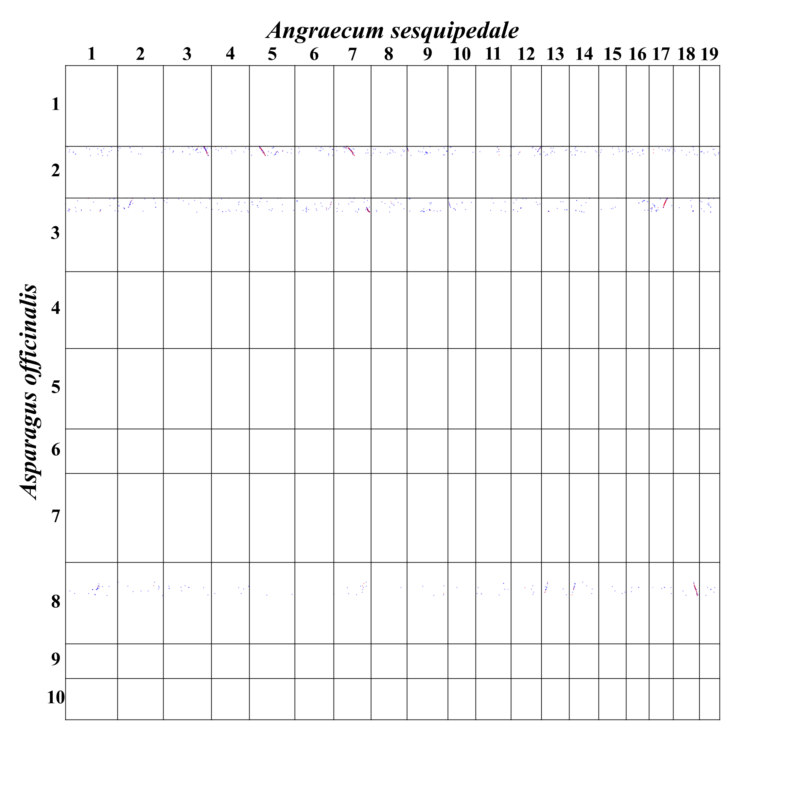
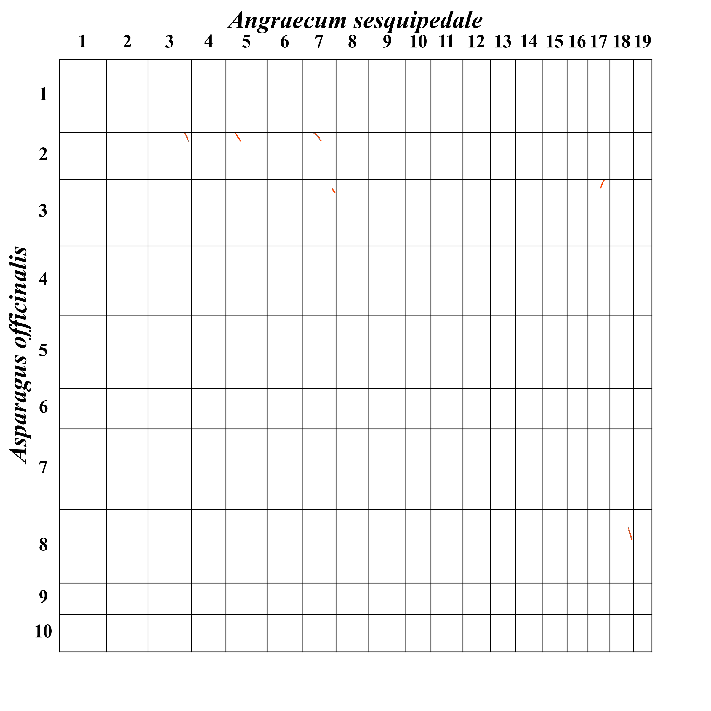

# Aster Collinearity

Scripts for protein homology searches, collinear block identification, synonymous substitution analysis, and comparative genome dot plots. The workflow supports comparisons within a genome and between species, including forward and reverse comparisons.

The scripts use species abbreviations and prepared gene annotations, so they can also be used with species outside Asteraceae. The included demonstration uses *Asparagus officinalis* (`Aoff`) and *Angraecum sesquipedale* (`Ases`).

## Workflow

| Stage | Analysis | Plot | Main output |
| --- | --- | --- | --- |
| 1. Protein homology | BLASTP or DIAMOND | BLAST dot plot | `<query>_<subject>.blast` or `.diamond` |
| 2. Collinearity | ColinearScan (`blockscan`) | Collinear block dot plot | `<query>_<subject>.block.rr.txt` |
| 3. Substitution rates | CDS translation, protein alignment, and Ka/Ks calculation | Dot plot with block median Ks labels | `<query>_<subject>.ks.txt` |

A pair name such as `Aoff_Ases` means query = `Aoff`, subject/database = `Ases`. Reverse comparisons use a separate pair name, `Ases_Aoff`.

## Contents

```text
Aster_Collinearity/
├── README.md
├── collinearity-pipeline/
│   ├── README.md                  Detailed requirements, formats, and commands
│   ├── species_names.tsv         Abbreviation-to-species-name table
│   ├── 1_blast/                   Homology searches and BLAST dot plots
│   ├── 2_block/                   ColinearScan and block dot plots
│   └── 3_ks/                     Ka/Ks calculation and Ks dot plots
└── examples/
    └── Aoff_Ases/                 Selected precomputed plotting example
        ├── README.md
        ├── bed/                   Gene annotations and chromosome gene counts
        ├── blast/                 Selected BLAST hits
        ├── block/                 Complete selected collinear blocks
        ├── ks/                    Corresponding precomputed Ka/Ks values
        └── expected/              BLAST and block plot previews
```

See the [pipeline guide](collinearity-pipeline/README.md) for the complete analysis workflow, input formats, dependencies, and current limitations.

## Quick start: draw the example plots

The precomputed example lets you check the input formats and draw two plots using Python, without first running homology searches or identifying blocks. It contains selected records rather than a complete genome-wide analysis. See the [example guide](examples/Aoff_Ases/README.md) for its contents, preparation, and optional Ks plotting instructions.

Install the Python dependencies in your working environment:

```bash
python -m pip install pandas matplotlib
```

The following commands use Bash on Linux or WSL. Start in this `Aster_Collinearity` directory:

```bash
# Draw the selected BLAST hits.
python collinearity-pipeline/1_blast/dotplot_blast.py \
  --bed examples/Aoff_Ases/bed \
  --blast examples/Aoff_Ases/blast \
  --out work/blast_dot --processes 1

# The block plotter needs a pair's BLAST and block files together.
mkdir -p work/block_input
cp examples/Aoff_Ases/blast/Aoff_Ases.blast work/block_input/
cp examples/Aoff_Ases/block/Aoff_Ases.block.rr.txt work/block_input/

python collinearity-pipeline/2_block/dotplot_block.py \
  --bed examples/Aoff_Ases/bed \
  --data work/block_input \
  --out work/block_dot --min-genes 10 --processes 1
```

Outputs:

- `work/blast_dot/Aoff_Ases.png`
- `work/block_dot/Aoff_Ases.10.2400.png`

The Python dot plots place the query species on the vertical axis and the subject species on the horizontal axis. Compare the results with the previews below; font appearance may vary between environments.

| BLAST dot plot | Collinear block dot plot |
| --- | --- |
|  |  |

## Run the complete analysis

Prepare matching protein FASTA (`.pep`), CDS FASTA (`.cds`), seven-column gene annotations (`.new.gff`), and chromosome gene counts (`.lens`). These are described in the [input format section](collinearity-pipeline/README.md#input-files).

The complete workflow requires BLAST+ or DIAMOND, ColinearScan, and the Perl dependencies used for Ka/Ks calculation and plotting. Follow the [step-by-step commands](collinearity-pipeline/README.md#run-the-workflow) to run the analysis in a separate working directory.

The bundled plotting example does not contain protein or CDS FASTA files and is not an end-to-end calculation benchmark. Its precomputed Ks table can be used for the optional Ks plotting step after the required Perl modules and font are installed.

## Citation

Please cite the original methods and tools used in your analysis, including BLAST+ or DIAMOND, ColinearScan, ClustalW2, and BioPerl. Report the versions and parameters actually used for your results.
